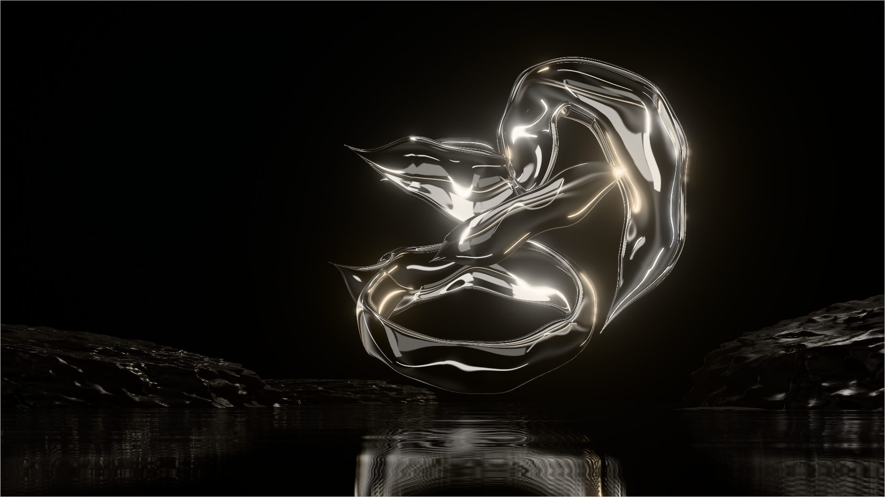

# NOIR® — Cinematic Hero

HERO independiente para NOIR®, estudio digital: escultura de metal líquido cromado en 3D real (Three.js), escenario de rocas húmedas sobre agua reflectante, tipografía editorial y entrada cinematográfica con GSAP. Solo el HERO: no hay más secciones.



## Cómo verlo

Los módulos ES necesitan servirse por HTTP (no abrir el archivo con `file://`):

```bash
npx serve projects/noir-hero
# o: python3 -m http.server --directory projects/noir-hero
```

Three.js `0.185.1` y GSAP `3.15.0` se cargan desde jsDelivr mediante un import map (`index.html`). Para producción con bundler, instala esas mismas versiones y elimina el import map.

## Archivos

| Archivo | Qué hace |
|---|---|
| `index.html` | Marcado del HERO (navegación, titular, etapas, controles) y arranque. |
| `noir-hero.css` | Composición editorial, responsive, estados hover/focus, intro sin JS de respaldo. |
| `noir-hero.js` | Controlador: intro GSAP, cursor/dedo, scroll, etapas, sonido, visibilidad y fallback. |
| `noir-scene.js` | Escena WebGL: cámara, estudio de luz, agua, rocas, bloom, bucle de render. |
| `noir-sculpture.js` | Geometría procedural de la escultura (cintas de metal líquido). |
| `noir-noise.js` | Ruido simplex 3D con semilla, para escultura y rocas. |
| `noir-audio.js` | Ambiente sonoro generado con Web Audio (sin archivos de audio). |
| `poster.jpg` | Fotograma de la propia escena 3D, usado solo si WebGL no está disponible. |

## Qué es 3D real y qué no

- **Escultura**: malla 3D real generada por código (cuatro cintas barridas a lo largo de curvas 3D, con ancho, orientación y concavidad por punto de control, bordes más gruesos que el centro como un líquido con tensión superficial, y una deformación orgánica común). Material `MeshPhysicalMaterial` metálico (metalness 1, roughness 0.06).
- **Iluminación**: un estudio procedural (cúpula oscura, tiras de luz tipo softbox, banda de ciclorama y su reflejo atenuado en el agua) horneado en un mapa PMREM. No hace falta ningún HDRI externo.
- **Agua**: espejo planar real (`Reflector`) con ondulación procedural, difuminado vertical y fundido a negro en el horizonte.
- **Rocas**: icosferas desplazadas con ruido, con un shader de basalto húmedo (grano en la normal, zonas mojadas brillantes y luces propias que no tocan el cromo).
- **Poster**: es un render fijo de esta misma escena, no una simulación. Solo aparece como fallback.

No falta ningún recurso externo. Si se quiere sustituir la escultura por un modelo esculpido a mano (p. ej. exportado de Blender), basta con cargar un `.glb` con `GLTFLoader` en `noir-scene.js` y asignar su geometría a `sculpture` en lugar de `buildSculptureGeometry()`; el resto de la escena (luz, agua, interacción) se mantiene. Del mismo modo, se puede cargar un HDRI de estudio con `HDRLoader`, pasarlo por `PMREMGenerator` y usarlo como `scene.environment`.

## Interacción

- **Entrada** (≈2,4 s): fundido desde negro, navegación, emergencia de la escultura, titular por líneas con máscara, texto y botón, etapas y controles.
- **Cursor / dedo**: orientación de la escultura, paralaje de cámara y rotación de las luces, todo interpolado. En táctil se usa la posición del dedo sin bloquear el scroll.
- **Etapas 01–04**: cambian orientación, rotación del estudio y temperatura del cromo sin reconstruir la interfaz. Avanzan solas cada 8 s (pausa al pasar el cursor o enfocar con teclado, con la pestaña oculta o el HERO fuera de vista).
- **Scroll**: el HERO queda fijado durante un tramo corto (`--noir-track`, 165svh por defecto; `100svh` lo desactiva). La escultura gira y se eleva levemente y el indicador SCROLL se rellena.
- **Sonido**: empieza apagado. El botón activa un ambiente generado (dron grave, lavado de agua, brillo agudo con reverberación) y su etiqueta refleja el estado real (`SOUND OFF` / `SOUND ON`, `aria-pressed`).

## Rendimiento y accesibilidad

- `data-quality="auto"` (por defecto) elige calidad baja en táctil, pantallas pequeñas o poca memoria; en escritorio empieza en alta y baja resolución y luego el bloom si no se sostienen ~40 fps. También acepta `"high"` y `"low"`.
- El render se detiene con la pestaña oculta o el HERO fuera de vista; los programas de shader se compilan antes del primer fotograma.
- `prefers-reduced-motion`: sin intro animada, sin flotación ni rotación automática, sin paralaje ni giro por scroll, sin autoavance de etapas.
- Todos los controles son enlaces o botones reales, con foco visible y etiquetas accesibles; la escena tiene descripción (`role="img"`).
- Si WebGL falla o se pierde el contexto, se muestra `poster.jpg`. Sin JavaScript, el poster aparece mediante `<noscript>`.

## Tipografía

- Logotipo y "BEYOND": Raleway 300 / 200.
- "THE INTERFACE": Fraunces (tamaño óptico 144, peso 330).
- Texto: Newsreader 300.
- Navegación y etiquetas: Hanken Grotesk.

Se eligieron midiendo anchura y altura de mayúsculas frente a la referencia.
